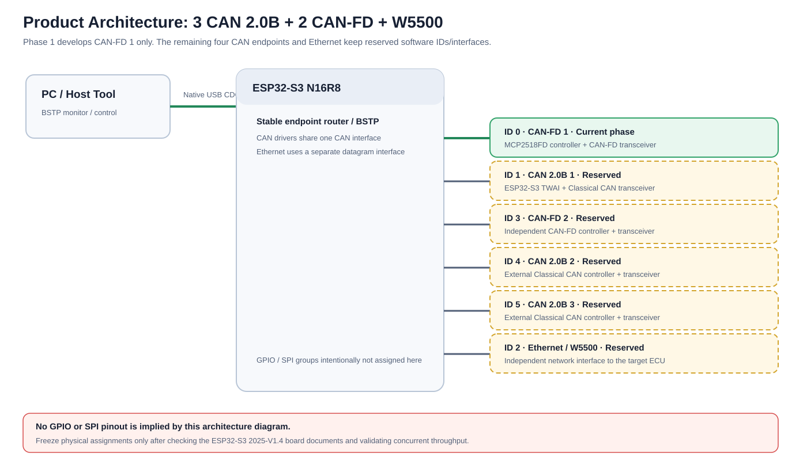
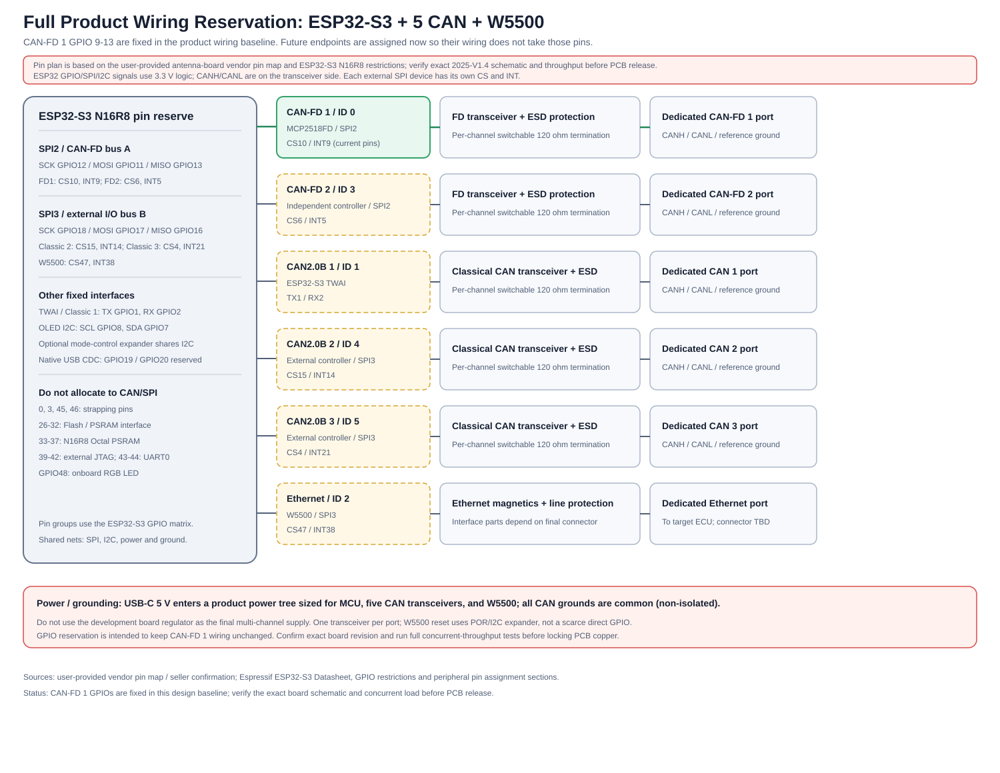
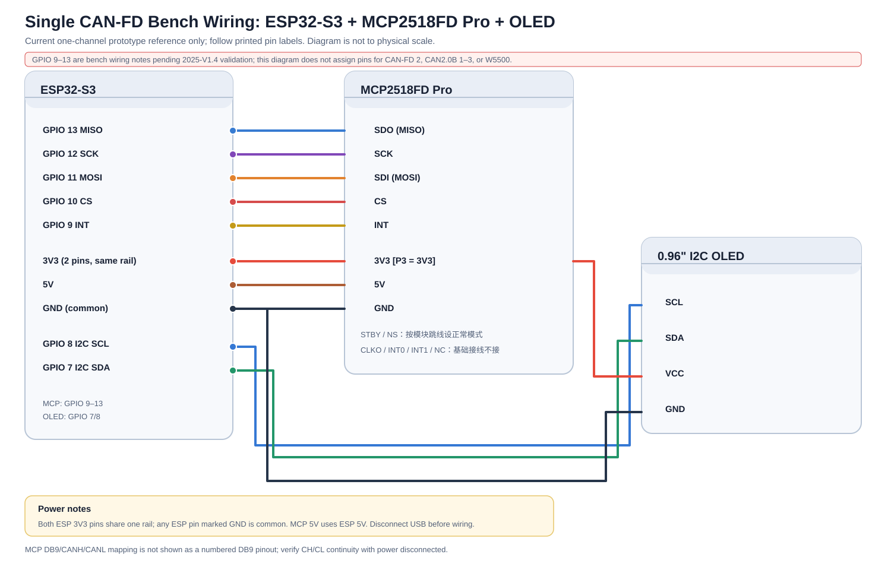
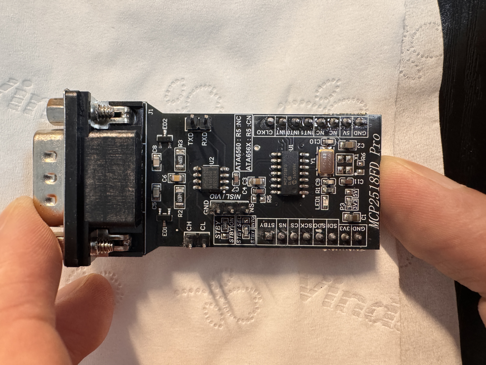

# ESP32-S3 五路 CAN 产品架构与开发板联调说明

## 产品架构与设计基线

| 项目 | 用户确认的目标 |
|---|---|
| CAN 物理口 | 3 路独立 CAN2.0B + 2 路独立 CAN-FD，共 5 路 |
| CAN-FD 数据段速率 | 两路目标最高 8 Mbps；典型负载，具体利用率/零丢帧验收值未定 |
| 以太网 | 保留 W5500 |
| 供电/隔离 | USB-C 5 V；非隔离，CAN 地与设备地共地 |

产品设计基线是 **3 路独立 CAN2.0B + 2 路独立 CAN-FD + W5500**。固件按交付阶段先实现 CAN-FD 1，但其余端口从架构、通道 ID 和驱动接口层面同步规划，不等硬件到手后再改软件架构。

| BSTP 通道 ID | 端点 | 阶段 | 预期硬件路径 |
|---:|---|---|---|
| 0 | CAN-FD 1 | 当前阶段 | MCP2518FD 控制器 + CAN-FD 收发器 |
| 1 | CAN2.0B 1 | 预留 | ESP32-S3 TWAI + 经典 CAN 收发器 |
| 2 | Ethernet | 预留 | W5500；独立网络接口，不是 CAN 控制器 |
| 3 | CAN-FD 2 | 预留 | 独立 CAN-FD 控制器 + 收发器 |
| 4 | CAN2.0B 2 | 预留 | 独立外部经典 CAN 控制器 + 收发器 |
| 5 | CAN2.0B 3 | 预留 | 独立外部经典 CAN 控制器 + 收发器 |

### 产品 GPIO / 总线分配预留

为避免以后加控制器时重接 CAN-FD 1，先按完整产品保留两组 SPI 总线。下表是当前**产品布线基线**，依据用户提供的天线版开发板引脚图（IMG_6560）及卖家对该板引脚布局的确认（IMG_6559）；不是从旧果云引脚图推导。ESP32-S3 GPIO Matrix 允许 SPI 信号映射到一般 GPIO。CAN-FD 1 的 GPIO 9–13 在本设计中固定预留；开发板版本与原理图仍须在 PCB 定版前逐项复核。

| 功能 / 器件 | 总线信号或 GPIO | 预留用途 |
|---|---|---|
| SPI2 / CAN-FD 总线 A | SCK GPIO 12、MOSI GPIO 11、MISO GPIO 13 | CAN-FD 1、CAN-FD 2 共用信号线 |
| CAN-FD 1 | CS GPIO 10、INT GPIO 9 | **产品基线固定；与当前 MCP2518FD 联调接线一致** |
| CAN-FD 2 | CS GPIO 6、INT GPIO 5 | 独立片选和中断 |
| SPI3 / 外设总线 B | SCK GPIO 18、MOSI GPIO 17、MISO GPIO 16 | Classic CAN 2/3 控制器与 W5500 共用信号线 |
| CAN2.0B 1 | TWAI TX GPIO 1、RX GPIO 2 | 使用 ESP32-S3 内置 TWAI |
| CAN2.0B 2 | CS GPIO 15、INT GPIO 14 | 独立外部经典 CAN 控制器 |
| CAN2.0B 3 | CS GPIO 4、INT GPIO 21 | 独立外部经典 CAN 控制器 |
| W5500 | CS GPIO 47、INT GPIO 38 | SPI3 上独立片选与中断；RSTn 由 I2C 扩展器或上电复位电路管理，不额外占用 MCU GPIO |
| OLED / I2C 扩展 | SCL GPIO 8、SDA GPIO 7 | 保留现有 OLED 接线；如需每路收发器模式控制，可在同一 I2C 总线增加 GPIO 扩展器 |
| USB CDC | GPIO 19/20 | 原生 USB 保留，不分配给 CAN/SPI |

计划上 SPI2 只承载两路 CAN-FD；SPI3 承载两路外置经典 CAN 控制器和 W5500。每个 SPI 器件独立 CS、独立 INT，避免后续新增设备占用 CAN-FD 1 的 GPIO。SPI 组负载仍须用双 FD、双经典 CAN、W5500 与 USB 并发测试；若测得吞吐不足，应在 PCB 定版前调整总线架构，而不是先把开发板单路连线误当最终产品图。

图中的“控制器 → 收发器”是每路 CAN 的功能链，不表示在现有 MCP2518FD Pro 模块外再串接一块收发器板；当前 Pro 模块已集成 CAN 收发器。产品板每个 CAN 物理口只配置一套收发器及其保护/终端网络。

**保留不用的引脚**：GPIO 0/3/45/46（启动绑带）、GPIO 19/20（USB）、GPIO 26–32（Flash/PSRAM）、GPIO 33–37（N16R8 八线 PSRAM）、GPIO 39–42（外部 JTAG 调试）、GPIO 43/44（UART0 调试）及 GPIO 48（当前开发板 RGB 灯）。GPIO 38 和 47 已按上表分配。GPIO 35–37 即使在排针图上可见，也不能因物理引出就视为可用。

**控制器模式脚**：每路收发器的 STBY/NSIL 必须有上电安全默认电平。若需要固件逐路切换模式或复位控制器/W5500，预留在 GPIO 7/8 的 I2C 扩展器上实现，避免额外占用关键 SPI/USB GPIO；扩展器型号和电气默认态需在最终器件选型后确认。即使 MCU/扩展器尚未启动，也必须由硬件电阻保证确定的安全状态。

**CAN-FD 1 引脚锁定**：GPIO 9 = INT、GPIO 10 = CS、GPIO 11 = MOSI、GPIO 12 = SCK、GPIO 13 = MISO。后续 CAN-FD 2 共用 SPI2 的 11/12/13，使用独立 CS GPIO 6 和 INT GPIO 5；其他 CAN 与 W5500 均分配到 SPI3，不占用 CAN-FD 1 的这些脚。除非准确的 V1.4 原理图发现板级冲突，或并发压力测试证明 SPI2 架构不满足目标，否则不改这组分配。

**资料依据与定版边界**：引脚分配依据用户提供的天线版板卡引脚图及卖家对该板布局的回复；芯片限制核对 [ESP32-S3 Datasheet: GPIO restrictions and peripheral pin assignment](https://documentation.espressif.com/esp32-s3_datasheet_en.pdf) 与 [ESP-IDF GPIO Matrix documentation](https://docs.espressif.com/projects/esp-idf/en/latest/esp32s3/api-reference/peripherals/gpio.html)。本地另有的核心板 PDF 元数据创建于 2024-07-22，不能作为 2025-V1.4 版本证明。因此这组脚是明确的产品布线基线，但 PCB 出图前仍需用准确的 V1.4 原理图复核，并完成并发压力测试。

ID 0–2 保留现有 BSTP v1 含义，新增端点只追加 ID，不重排或复用旧 ID。上位机定义见 `core/bstp.py:Chn`；固件的 CAN 驱动与 Ethernet 数据报接口见 `demo/fireware/main/busspy_interfaces.h`。CAN 控制器经统一 CAN 驱动接口接入；W5500 使用独立 Ethernet 接口，避免把网络包伪装成 CAN 通道。驱动配置、收发和状态接口按通道实例化，使每路配置/错误计数可以独立维护。

主控资源按完整产品规划：ESP32-S3 的 1 个 TWAI 用于 CAN2.0B 1，其余 4 个 CAN 控制器与 W5500 按上表分到两个 SPI host。两路 CAN-FD 目标数据段速率为 8 Mbps。SPI 时钟、FIFO 水位、中断优先级、USB 上传与 W5500 并发负载均需作为产品验收项验证；未验证前不承诺满载零丢帧。

**实施顺序不改变产品边界**：第一阶段实现 CAN-FD 1 的 MCP2518FD 驱动和 BSTP 数据路径；Classic CAN、第二路 CAN-FD 和 W5500 分阶段落地，但其通道模型、错误/状态接口和产品资源预算从现在开始保持一致。当前固件代码尚未包含 MCP2518FD 实际驱动。

**产品板要求**：每路 CAN 独立连接器与收发器；每路单独设计可配置的 120 Ω 终端、ESD/浪涌保护和地参考。当前用户选定非隔离，所有 CAN 端与 USB/设备地共地，必须做共模电压、地环流和故障能量评估。USB-C 5 V 供电需按 ESP32-S3、5 路收发器、W5500 的峰值电流和热耗散重新做电源预算；不能直接沿用开发板稳压器假设。

## CAN-FD 1 开发板联调连接记录

此图是现有开发板与 MCP2518FD Pro 模块、OLED 的联调接线子集，不是产品 PCB 供电、保护或连接器图。CAN-FD 1 的信号 GPIO 按上表固定为产品布线基线：SPI2 SCK/MOSI/MISO = GPIO 12/11/13、CS = GPIO 10、INT = GPIO 9；后续 CAN-FD 2 使用同一组 SPI 线及独立 GPIO 6/5。只有当 2025-V1.4 板级核对发现冲突，或并发性能验证不通过时，才调整这组分配。

### 开发板到 MCP2518FD Pro 模块

| ESP32-S3 开发板针脚 | MCP2518FD Pro 针脚 | 用途 |
|---|---|---|
| GPIO 12 | SCK | SPI 时钟，当前联调接法 |
| GPIO 11 | SDI | SPI MOSI |
| GPIO 13 | SDO | SPI MISO |
| GPIO 10 | CS | SPI 片选，低电平有效 |
| GPIO 9 | INT | MCP 中断输出 |
| 3V3 | 3V3 | 模块逻辑 I/O 电源；P3 选择 3V3 |
| 5V | 5V | 模块 5V 输入 |
| GND | GND | 共地 |

SPI 信号为 3.3V 逻辑，不要把模块 P3 设为 5V 逻辑。开发板上的两个 `3V3` 针脚属于同一条 3.3V 电源轨；所有标有 `GND` 的针脚共地，但不可将 GPIO 当作 GND。

## ESP32-S3 到 OLED

| ESP32-S3 针脚 | OLED 针脚 | 用途 |
|---|---|---|
| GPIO 8 | SCL | I2C 时钟 |
| GPIO 7 | SDA | I2C 数据 |
| 3V3 | VCC | 屏幕供电；模块规格未确认前不要接 5V |
| GND | GND | 共地 |

当前使用的是新款 OLED：针脚顺序为 `GND`、`VCC`、`SCL`、`SDA`；背面丝印给出 `0x78` / `0x7A` 两个地址选项，按常见 8 位写地址表示法对应 7 位地址 `0x3C` / `0x3D`。焊桥地址需扫描确认；控制器按新款资料优先评估 SSD1315，详见 [OLED 接线说明](./OLED接线说明.md)。

## MCP2518FD Pro 排针功能

以下名称按模块照片上的丝印记录；模块方向不同会改变它们在照片中的上下/左右位置，接线时认针脚文字，不要只按“左排/右排”判断。

| MCP 模块丝印 | 功能 | 基础接线建议 |
|---|---|---|
| STBY | 板载 CAN 收发器待机控制 | **必须定义电平**；产品上用默认电阻/跳线保证上电处于所需模式，可选 MCU 控制 |
| NS | 板载收发器的 NSIL（Normal/Silent）控制；照片上芯片区域标有 `NSIL/VIO` | **必须定义电平**；不是 CANH/CANL。产品上按收发器版本设正常/静默默认态，可选 MCU 控制 |
| CS | MCP2518FD SPI 片选，低有效 | 接 ESP GPIO 10 |
| SCK | SPI 时钟输入 | 接 ESP GPIO 12 |
| SDO | SPI 数据输出（MISO） | 接 ESP GPIO 13 |
| SDI | SPI 数据输入（MOSI） | 接 ESP GPIO 11 |
| 3V3 | 逻辑 I/O 电源 | 接 ESP 3V3；P3 选择 3V3 |
| GND（两处） | 地 | 与 ESP 共地 |
| CLKO | MCP 时钟输出 | 基础 SPI 通信不需要，可不接 |
| INT | MCP 主中断输出 | 推荐接 ESP GPIO 9；只有采用轮询驱动时才可不接，产品固件通常应优先使用中断 |
| INT0、INT1 | MCP 可配置辅助 GPIO/中断功能（以模块原理图和芯片配置为准） | 不用相关功能时可不接；产品 PCB 可留测试焊盘，固件勿配置成未定义的输出状态 |
| NC（两处） | 未连接/预留 | 保持不接，不要在产品 PCB 上擅自接电源或信号 |
| 5V | 模块 5V 供电输入 | 接 ESP 5V |

模块上的 `STBY`、`NS`/`NSIL` 模式选择与板载收发器版本、焊桥设置有关。不要因为接口排针上有这些脚就直接接到 ESP GPIO；先按板上选择位/模块资料设为正常收发模式。常见 ATA6560 系列的正常模式逻辑为 STBY 低、NSIL 高，但此板丝印还标出收发器变体，实际以模块配置为准。

`CLKO` 是 MCP 的时钟输出，不是正常 SPI 通信所需的时钟输入；不使用该输出时可不接。成熟产品可以把它引到测试点，便于测量时钟，但只有确认有诊断/同步用途后才需要接 MCU。这里的“可不接”表示该功能未使用时允许保持未连接，不代表所有排针都可以悬空：`STBY` 和 `NS`/`NSIL` 仍须有确定的默认状态。

## CAN 总线端

照片上可见 `CH`、`CL` 测试点，分别标示 CANH、CANL。DB9 的具体针脚映射不能仅凭外观确认；若要确认本模块 DB9 的 CANH/CANL 针脚，先断电，再用万用表通断档从 CH/CL 测到 DB9 针脚。不要把常见 DB9 标准针脚号直接当成本模块已验证的映射。

## 实物参考照片

这些照片保留原始内容，用于核对板上丝印和模块版本；实际接线仍以手上板子的标记为准。

### MCP2518FD Pro

### OLED 模块背面

## 接线与上电顺序

1. 拔掉 ESP32-S3 USB 电源。
2. 先接 MCP 的 SPI、INT、3V3、5V、GND，再接 OLED 的 SCL、SDA、VCC、GND。
3. 确认 MCP 模块 P3 选 3V3，OLED VCC 接 ESP 3V3，所有 GND 共地，且没有短接。
4. 再接 USB 上电；先做 I2C 扫描与 MCP SPI 识别测试，不要在未确认 CAN 收发器模式和总线接线前接入车辆/带电 CAN 网络。
