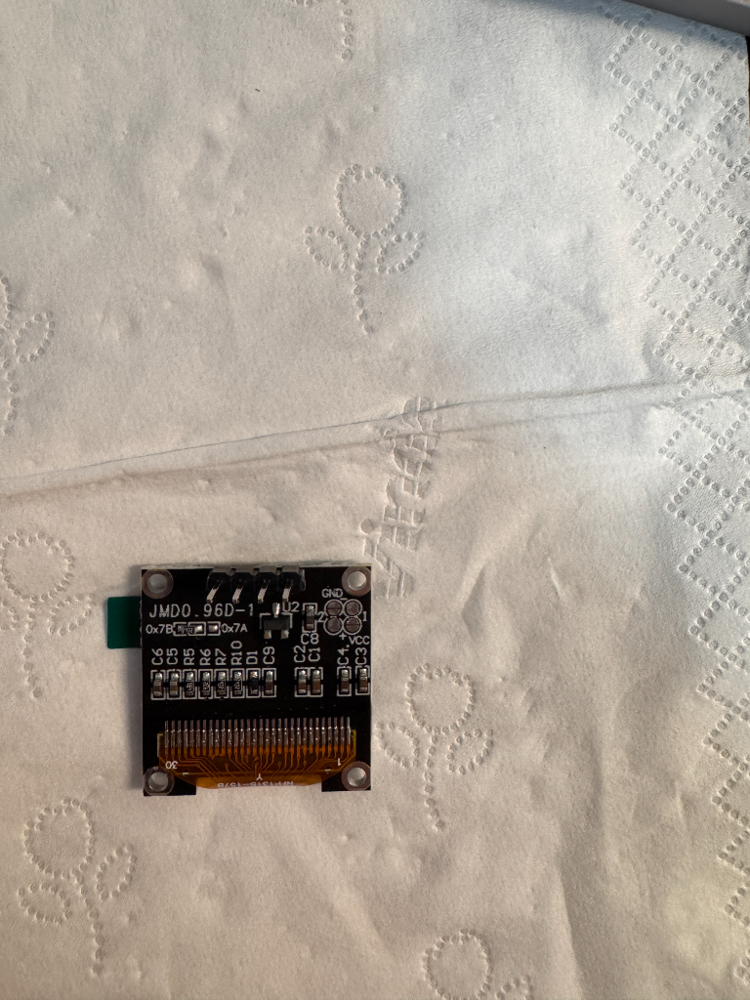

# ESP32-S3、MCP2518FD Pro 与 OLED 硬件针脚说明

## 三板合接图

图中 GPIO 分配对应本项目当前原型接法；连线是逻辑示意，不代表开发板排针的物理排列方向。接线前请以各板实际丝印为准。

## ESP32-S3 到 MCP2518FD Pro

| ESP32-S3 针脚 | MCP2518FD Pro 针脚 | 用途 |
|---|---|---|
| GPIO 12 | SCK | SPI 时钟，ESP32 输出 |
| GPIO 11 | SDI | SPI MOSI，ESP32 向 MCP 发送 |
| GPIO 13 | SDO | SPI MISO，MCP 向 ESP32 返回 |
| GPIO 10 | CS | SPI 片选，低电平有效 |
| GPIO 9 | INT | MCP 中断输出，通知 ESP32 读取接收 FIFO/状态 |
| 3V3 | 3V3 | MCP 模块逻辑 I/O 电源；将模块 P3 选择到 3V3 |
| 5V | 5V | MCP 模块的 5V 供电输入，供板上 CAN 收发器电源部分使用 |
| GND | GND | 共地 |

ESP32-S3 的 SPI 信号使用 3.3V 逻辑。不要把模块 P3 设为 5V 逻辑。

开发板上的两个 `3V3` 针脚属于同一条 3.3V 电源轨，可以分别给 MCP 的 `3V3` 和 OLED 的 `VCC` 供电；也可以从一个 `3V3` 针脚分接。所有标有 `GND` 的 ESP32 针脚共地，接任意一个标有 `GND` 的针脚即可；不要把“共地”理解为 GPIO 或其他针脚也能接地。

## 面向双 CAN-FD 的后续预留方案

用户的目标是后续扩展为双 CAN-FD，并尽可能保留 CAN2.0B。按 ESP32-S3 现有资源，建议暂按 **2 路 MCP2518FD + 1 路内置 TWAI** 规划，即 3 路独立物理 CAN 总线，其中两路可运行 CAN-FD，另一路为经典 CAN。MCP2518FD 本身也支持经典 CAN，因此模式可按通道配置。

| 预留功能 | 接线/引脚候选 | 说明 |
|---|---|---|
| MCP2518FD #1（当前） | SPI：GPIO 11/12/13；CS：GPIO 10；INT：GPIO 9 | 当前图示接法 |
| MCP2518FD #2（未来） | 与 #1 共用 SPI SCK/MOSI/MISO；候选 CS：GPIO 15，INT：GPIO 16 | 每个控制器要有独立 CS 和独立 INT；须核对开发板完整引脚图，并避开后续 W5500 等外设 |
| 经典 CAN/TWAI（保留） | 候选 TX：GPIO 4，RX：GPIO 5 | ESP32-S3 内置 TWAI 只有 1 个；配一只 CAN 收发器即可保留 1 路 CAN2.0B |
| OLED | GPIO 8（SCL）、GPIO 7（SDA） | 与上述 SPI/TWAI 信号分开 |

这套分配可保留 **3 路物理总线（2 路 CAN-FD 能力 + 1 路经典 CAN）**；并不是 3 路经典 CAN 再额外加 2 路 CAN-FD。若产品目标改成更多独立总线，每增加一路都需要一个独立 CAN 控制器和收发器；ESP32-S3 的 GPIO 只负责控制/数据接口，不能凭空增加 CAN 控制器通道。

两颗 MCP2518FD 可以作为不同 SPI 设备共用同一组 SCK/MOSI/MISO，但必须分配独立 CS，并建议各自保留独立 INT。SPI 事务会串行执行；双路高负载 CAN-FD 的实际吞吐、时间戳和丢帧情况必须在目标波特率与负载下压测，不能仅凭单路 8 Mbps 规格承诺双路满载。GPIO 4/5/15/16 目前只是候选，最终 PCB 前还要结合开发板完整引脚、USB、启动绑带、W5500、供电和布线一并复核。

产品化时不要把原型阶段“可不接”理解为“最终板上无用”：为 `STBY`/`NS` 设计确定的硬件默认状态，必要时预留 MCU 控制；为 `CLKO`、`INT0`、`INT1` 留测试焊盘或明确标为 NC；`NC` 仍保持不接。每路 CAN 还需独立连接器、ESD/浪涌保护、可配置终端电阻和明确的隔离/接地策略。

## ESP32-S3 到 OLED

| ESP32-S3 针脚 | OLED 针脚 | 用途 |
|---|---|---|
| GPIO 8 | SCL | I2C 时钟 |
| GPIO 7 | SDA | I2C 数据 |
| 3V3 | VCC | 屏幕供电；模块规格未确认前不要接 5V |
| GND | GND | 共地 |

OLED 背面丝印给出 `0x78` / `0x7A` 两个地址选项，按常见 8 位写地址表示法对应 7 位地址 `0x3C` / `0x3D`。当前焊桥选择及控制器型号仍需扫描/核对；详见 [OLED 接线说明](./OLED接线说明.md)。

## MCP2518FD Pro 排针功能

以下名称按模块照片上的丝印记录；模块方向不同会改变它们在照片中的上下/左右位置，接线时认针脚文字，不要只按“左排/右排”判断。

| MCP 模块丝印 | 功能 | 基础接线建议 |
|---|---|---|
| STBY | 板载 CAN 收发器待机控制 | **必须定义电平**；产品上用默认电阻/跳线保证上电处于所需模式，可选 MCU 控制 |
| NS | 板载收发器的 NSIL（Normal/Silent）控制；照片上芯片区域标有 `NSIL/VIO` | **必须定义电平**；不是 CANH/CANL。产品上按收发器版本设正常/静默默认态，可选 MCU 控制 |
| CS | MCP2518FD SPI 片选，低有效 | 接 ESP GPIO 10 |
| SCK | SPI 时钟输入 | 接 ESP GPIO 12 |
| SDO | SPI 数据输出（MISO） | 接 ESP GPIO 13 |
| SDI | SPI 数据输入（MOSI） | 接 ESP GPIO 11 |
| 3V3 | 逻辑 I/O 电源 | 接 ESP 3V3；P3 选择 3V3 |
| GND（两处） | 地 | 与 ESP 共地 |
| CLKO | MCP 时钟输出 | 基础 SPI 通信不需要，可不接 |
| INT | MCP 主中断输出 | 推荐接 ESP GPIO 9；只有采用轮询驱动时才可不接，产品固件通常应优先使用中断 |
| INT0、INT1 | MCP 可配置辅助 GPIO/中断功能（以模块原理图和芯片配置为准） | 不用相关功能时可不接；产品 PCB 可留测试焊盘，固件勿配置成未定义的输出状态 |
| NC（两处） | 未连接/预留 | 保持不接，不要在产品 PCB 上擅自接电源或信号 |
| 5V | 模块 5V 供电输入 | 接 ESP 5V |

模块上的 `STBY`、`NS`/`NSIL` 模式选择与板载收发器版本、焊桥设置有关。不要因为接口排针上有这些脚就直接接到 ESP GPIO；先按板上选择位/模块资料设为正常收发模式。常见 ATA6560 系列的正常模式逻辑为 STBY 低、NSIL 高，但此板丝印还标出收发器变体，实际以模块配置为准。

`CLKO` 是 MCP 的时钟输出，不是正常 SPI 通信所需的时钟输入；不使用该输出时可不接。成熟产品可以把它引到测试点，便于测量时钟，但只有确认有诊断/同步用途后才需要接 MCU。这里的“可不接”表示该功能未使用时允许保持未连接，不代表所有排针都可以悬空：`STBY` 和 `NS`/`NSIL` 仍须有确定的默认状态。

## CAN 总线端

照片上可见 `CH`、`CL` 测试点，分别标示 CANH、CANL。DB9 的具体针脚映射不能仅凭外观确认；若要确认本模块 DB9 的 CANH/CANL 针脚，先断电，再用万用表通断档从 CH/CL 测到 DB9 针脚。不要把常见 DB9 标准针脚号直接当成本模块已验证的映射。

## 实物参考照片

这些照片保留原始内容，用于核对板上丝印和模块版本；实际接线仍以手上板子的标记为准。

### MCP2518FD Pro

### OLED 模块背面

## 接线与上电顺序

1. 拔掉 ESP32-S3 USB 电源。
2. 先接 MCP 的 SPI、INT、3V3、5V、GND，再接 OLED 的 SCL、SDA、VCC、GND。
3. 确认 MCP 模块 P3 选 3V3，OLED VCC 接 ESP 3V3，所有 GND 共地，且没有短接。
4. 再接 USB 上电；先做 I2C 扫描与 MCP SPI 识别测试，不要在未确认 CAN 收发器模式和总线接线前接入车辆/带电 CAN 网络。
