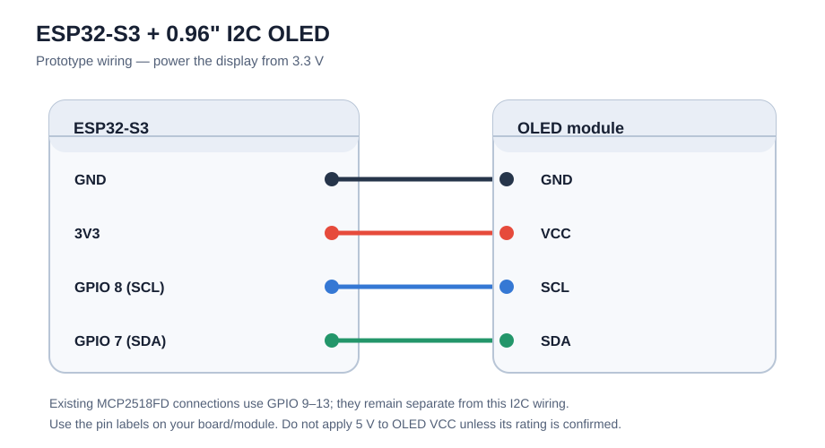

# ESP32-S3 与 0.96 英寸 OLED 接线

ESP32-S3、MCP2518FD 与 OLED 三块板的完整合接图和 MCP 针脚功能见
[硬件针脚说明](./HARDWARE_PINOUT.md)。

## 模块识别与规格

- 模块背面丝印：`JMD0.96D-I`。
- 当前实物为**新款**，不是商品资料中展示的老款；接线顺序和控制器判断按新款资料记录。
- 商品资料标注：0.96 英寸、128×64、白色、I2C、3.3–5 V 直流供电、约 27×27×4.1 mm；OLED 自发光，无需背光。接入 ESP32 时仍建议用 3.3 V，避免任何 I2C 上拉到 5 V。
- 新款实物正面排针从屏幕朝上且排针在上时，从左到右为：`GND`、`VCC`、`SCL`、`SDA`。商品资料展示的老款顺序是 `VCC`、`GND`、`SCL`、`SDA`，不可套用到这块新款屏。
- 背面有 `0x78` / `0x7A` 地址选项。它们是常见的 8 位写地址表示法，对应 I2C 7 位地址 `0x3C` / `0x3D`。照片不能确定当前焊桥选中了哪一个。
- 商品参数表标 `SSD1306`，但新款说明标 `SSD1315`。由于当前实物芯片型号无法从外观确认，驱动按新款资料优先以 `SSD1315` 评估，并通过初始化和显示测试验证；不能仅凭 I2C 地址或外观断定控制器。

实物背面参考：[OLED-JMD0.96D-I-back.png](./images/hardware-reference/OLED-JMD0.96D-I-back.png)。

## 接线定义

| OLED 针脚 | ESP32-S3 | 用途 |
|---|---|---|
| GND | GND | 共地 |
| VCC | 3V3 | 屏幕供电；虽然商品规格标注 3.3–5 V，接 ESP32 时仍建议用 3.3 V |
| SCL | GPIO 8 | I2C 时钟 |
| SDA | GPIO 7 | I2C 数据 |

GPIO 7/8 是本项目给 OLED 预留的 I2C 引脚；既有 MCP2518FD SPI/中断接线使用 GPIO 9–13，不与其冲突。ESP32-S3 的 I2C 信号可通过 GPIO 矩阵映射，但固件应按此接线初始化。

## 首次上电检查

1. 拔掉 ESP32-S3 的 USB 电源后再接线，确认 OLED 排针方向和丝印。
2. 连接后检查没有把 VCC 与 GND 接反，再接 USB。
3. 固件以 GPIO 8/7 初始化 I2C 并扫描设备；预期地址通常为 `0x3C` 或 `0x3D`，以扫描结果为准。
4. 地址确认后按新款资料优先测试 `SSD1315` 驱动；若初始化或显示异常，再核对控制器资料/兼容驱动。不要把 `0x78` 直接当作常见 I2C API 所需的 7 位地址。
